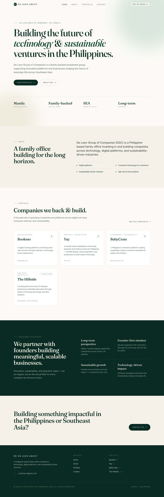
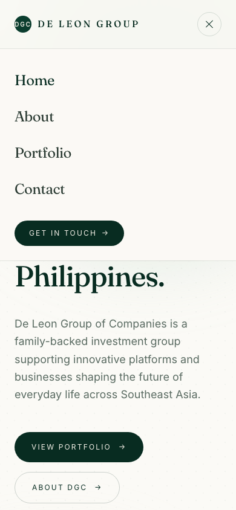
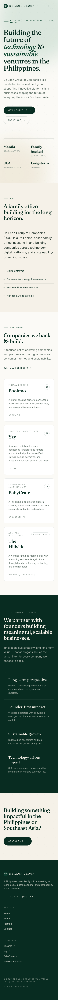
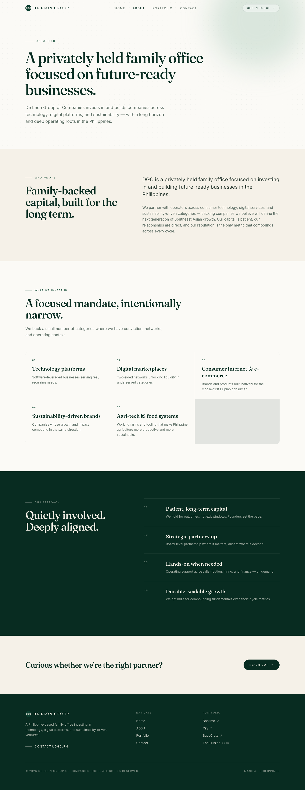
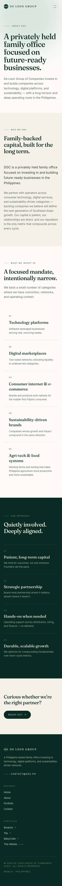
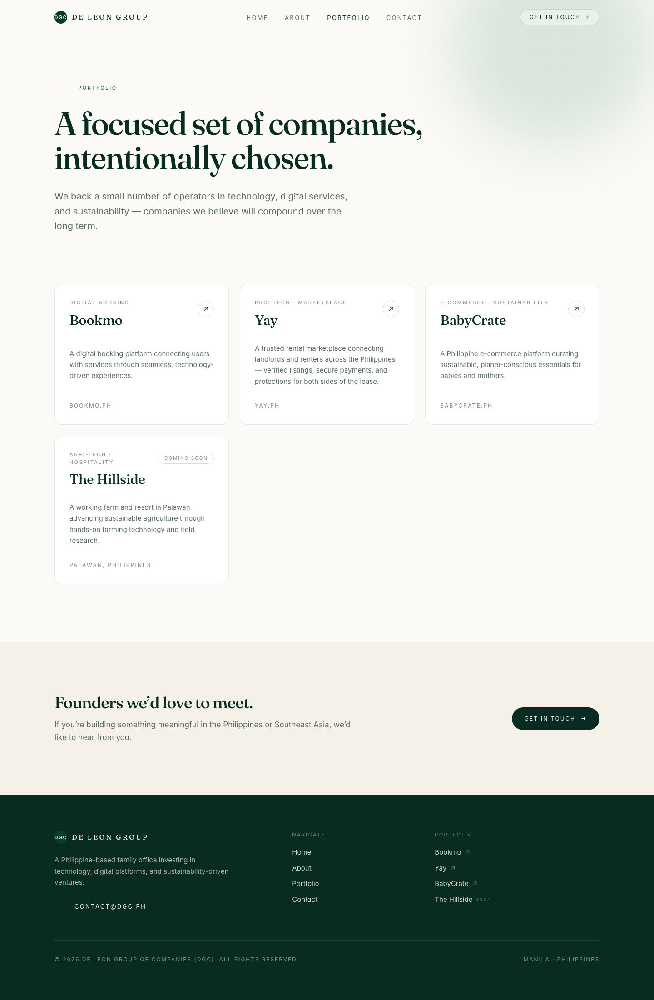
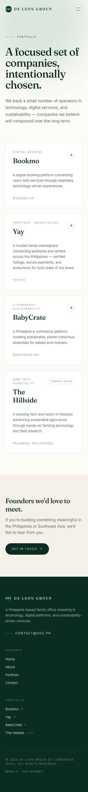
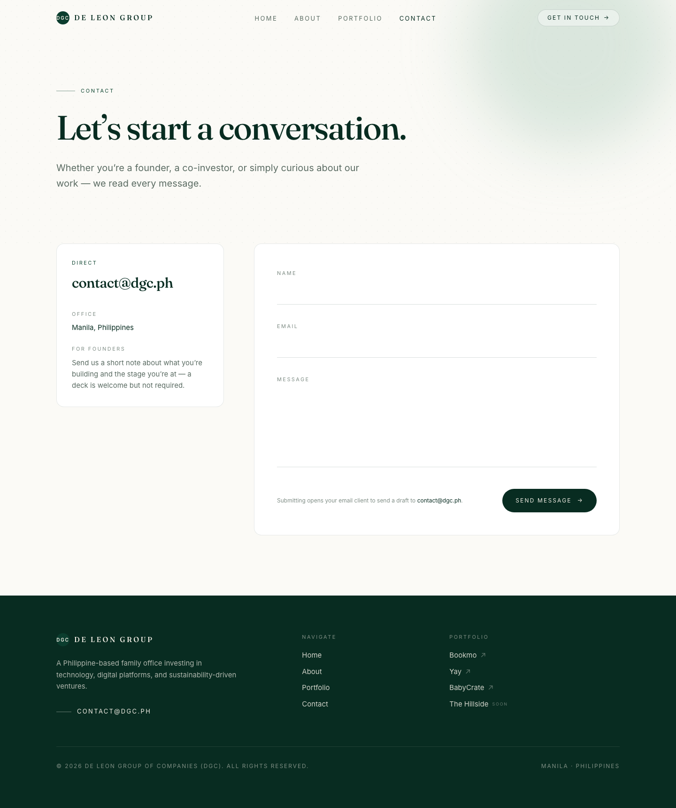
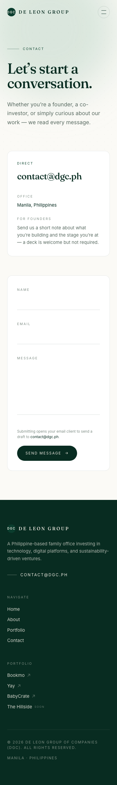

# User manual

This page is the user manual for dgc.ph: it describes each page of the website and the navigation bar and footer that appear on every page, what each one is for and how to use it. Screenshots show the site on a desktop screen and on a phone.

## Navigation bar

The navigation bar sits at the top of every page and stays there as you scroll. It lets you move between the four pages from anywhere on the site.

- Click the **De Leon Group** logo to go back to the Home page.
- On a desktop screen, click **Home**, **About**, **Portfolio** or **Contact**. The page you are on is shown in a darker colour.
- Click **Get in touch** on the right to go straight to the Contact page.
- On a phone, the links are hidden behind the round menu button at the top right. Tap it to open the menu, then tap a page. Tap the button again (it turns into an ×) to close the menu without leaving the page.
- Keyboard users can press Tab once on any page to reveal a **Skip to content** link that jumps past the navigation bar.

{ width="720" }

{ width="300" }

## Home

The Home page (`/`) introduces DGC in one screen and gives a short tour of everything else on the site. Visitors who open an address that doesn't exist on the site also see this page.

From top to bottom it shows:

- **The headline**: DGC is building the future of technology and sustainable ventures in the Philippines, with two buttons: **View portfolio** and **About DGC**.
- **Four quick facts**: Manila headquarters, family-backed capital, a Southeast Asia growth focus and a long-term horizon.
- **About**: a one-paragraph summary and the four areas DGC focuses on.
- **Portfolio**: a card for each company. Click a card to open that company's website in a new tab. A card marked **Coming soon** has no website yet. **See full portfolio** opens the Portfolio page.
- **Investment philosophy**: the four principles DGC uses to choose companies.
- **Contact us**: a button that opens the Contact page.

{ width="720" }

{ width="300" }

## About

The About page (`/about`) explains who DGC is and how it works with the companies it backs. It is the page to send to a founder or partner who wants to understand DGC before getting in touch.

It has four parts:

- **Who we are**: DGC as a privately held, family-backed office focused on future-ready businesses in the Philippines.
- **What we invest in**: the five categories DGC backs, from technology platforms to agri-tech and food systems.
- **Our approach**: four numbered points on how DGC works with founders, such as patient capital and hands-on support when it is needed.
- **Reach out**: a button that opens the Contact page.

{ width="720" }

{ width="300" }

## Portfolio

The Portfolio page (`/portfolio`) lists the companies DGC backs and builds: Bookmo, Yay, BabyCrate and The Hillside.

- Each card shows the company's sector, name and a short description.
- Click a card with an ↗ arrow to open that company's website in a new tab. The address is shown at the bottom of the card.
- A card marked **Coming soon** (The Hillside) has no website yet, so clicking it does nothing. It shows the company's location instead.
- At the bottom, **Get in touch** opens the Contact page for founders who want to talk to DGC.

{ width="720" }

{ width="300" }

## Contact

The Contact page (`/contact`) is how visitors reach DGC. It gives DGC's email address and a short form for writing a message.

To send a message:

1. Fill in **Name**, **Email** and **Message**. All three are required.
2. Click **Send message**.
3. Your email app opens with a new email to `contact@dgc.ph`, with your name in the subject and your message, name and email in the body. Check it and send it from your email app. Nothing is sent until you do.

If no email app opens (for example, on a shared computer with no email set up), copy the address `contact@dgc.ph` from the box beside the form and write to it from any email service. Clicking that address also opens your email app.

The box also shows DGC's office location (Manila, Philippines) and a tip for founders: send a short note about what you're building and your stage; a pitch deck is welcome but not required.

{ width="720" }

{ width="300" }

## Footer

The footer sits at the bottom of every page. It repeats the most useful links so visitors don't have to scroll back up.

- **contact@dgc.ph**: click to open your email app with a new email to DGC.
- **Navigate**: links to Home, About, Portfolio and Contact.
- **Portfolio**: links to each company's website, which open in a new tab. Companies without a website yet are marked **Soon**.
- The bottom line shows the copyright notice and DGC's location.

{ width="720" }

{ width="300" }
